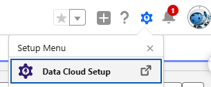
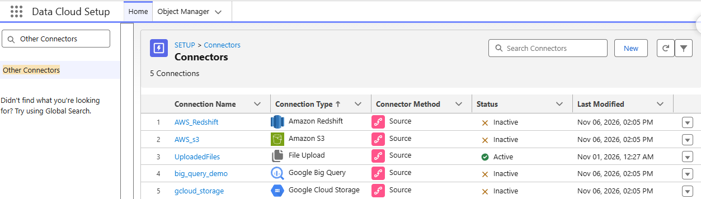
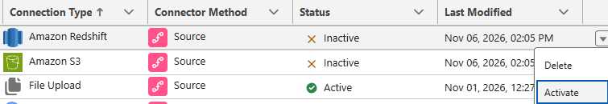
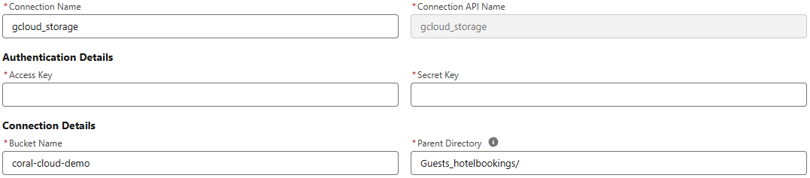

# Datakit conexiones


## Antes de instalar el Datakit


### Subir los datos a las plataformas cloud
Antes de instalarlo, es necesario subir los datos a las nubes de AWS y GCP
Podemos ayudarnos de este repositorio https://github.com/fatimafer/aws_gcloud.git

### Creación del playground
Una vez subidos los datos a las nubes correspondientes, creamos un playground de DATA 360 a través de esta página
Este Datakit puede ser usado con el Data 360 Playground de esta  página:
https://trailhead.salesforce.com/es/content/learn/projects/connect-data-cloud-to-copilot-and-prompt-builder/enhance-copilot-to-act-on-data-with-conversational-language

### Crear Private Connect
Antes de comenzar, es necesario crear una conexión privada a AWS Redshift en el Playground creado. Podemos ayudarnos de los siguientes recursos:
[Guía Private Connect Data 360 - Redshift](Guia_conexion_privada_Redshift_Data360.pdf)
https://help.salesforce.com/s/articleView?id=data.c360_a_private_connect_redshift.htm&type=5


## Instalar el Datakit

Después, descargamos los datos de prueba.

Para ello es necesario disponer de un terminal con SALESFORCE CLI instalado. Para instalar Salesforce CLI en un terminal, es necesario seguir estas instrucciones
https://developer.salesforce.com/docs/platform/sfdx-setup/guide/sfdx-setup-install-cli.html

Clonamos el repositorio con los datos de prueba Y nos movemos a su carpeta
```
git clone https://github.com/trailheadapps/coral-cloud
```
```
cd coral-cloud
```

Hacemos Login en Salesforce CLI y configuramos la organización como destino predterminado
```
sf org login web -s -a coral-cloud
```
```
sf config set target-org coral-cloud --global
```

Desplegamos la metadata
```
git switch -c org-nueva
B=cc-base-app/main/default/objects
sed -i 's#<relationshipOrder>[01]<#<relationshipOrder>0<#' $B/Booking__c/fields/Contact__c.field-meta.xml $B/Guest_Review__c/fields/Contact__c.field-meta.xml
sed -i 's#<relationshipOrder>[01]<#<relationshipOrder>1<#' $B/Booking__c/fields/Session__c.field-meta.xml $B/Guest_Review__c/fields/Experience__c.field-meta.xml
git diff --stat && sf project deploy start -d cc-base-app
```

Asignamos el permission set Prompt Template Manager 
```
sf org assign permset -n EinsteinGPTPromptTemplateManager
```

Desplegamos el agente
```
sf project deploy start -d cc-employee-app/main/default/classes && \
sf project deploy start -d cc-employee-app/main/default/genAiPromptTemplates && \
sf project deploy start -d cc-employee-app
```

Asignamos los permission set restantes
```
sf org assign permset -n Coral_Cloud_Admin
```
```
sf org assign permset -n Coral_Cloud_Employee_Agent_Access
```

Borramos los datos anteriores
```
sf apex run -f apex-scripts/wipe-data.apex
```

Importamos datos de ejemplo del repositorio
```
sf data tree import -p ./data/data-plan.json
```

Generamos datos de ejemplo adicionales
```
sf apex run -f apex-scripts/setup.apex
```

Instalamos otro Datakit

```
sf package install -p 04tHr000000ku4k -w 10
```


## Instalar el Datakit

Una vez realizados los pasos anteriores abrimos un terminal con Salesforce CLI instalado, preferentemente en VSCODE

Si es otra terminal o no conectados a al playground creado, nos conectamos
```
sf org login web -s -a coral-cloud
```

Testeamos primero el despliegue
```
sf project deploy start --manifest manifest/package.xml --target-org coral-cloud --dry-run
```

Y si todo ha ido bien, desplegamos
```
sf project deploy start --manifest manifest/package.xml --target-org coral-cloud
```


## Activar las conexiones

Dado que estas conexiones viajan sin credenciales por motivos de seguridad, una vez importadas permanecerán inactivas.

* Para comprobarlo, hacemos click en el engranaje de la parte superior derecha y seleccionamos Data Cloud Setup

    

* En el botón de búsqueda, escribimos Other Connectors y hacemos click en Other Connector en el panerl izquierdo. Podemos observar que, efectivamente están inactivas

    

* Para asignar las credenciales y datos de conexión faltantes hacemos click en activar

    

* En este ejemplo vemos que access key y secret key están vacíos, por lo tanto habría que completarlos Además hay que revisar si los datos de Bucket Name y Parent Directory siguen siendo correctos o es necesario modificarlos según los nombres asignados en nuestras plataformas cloud.

    
